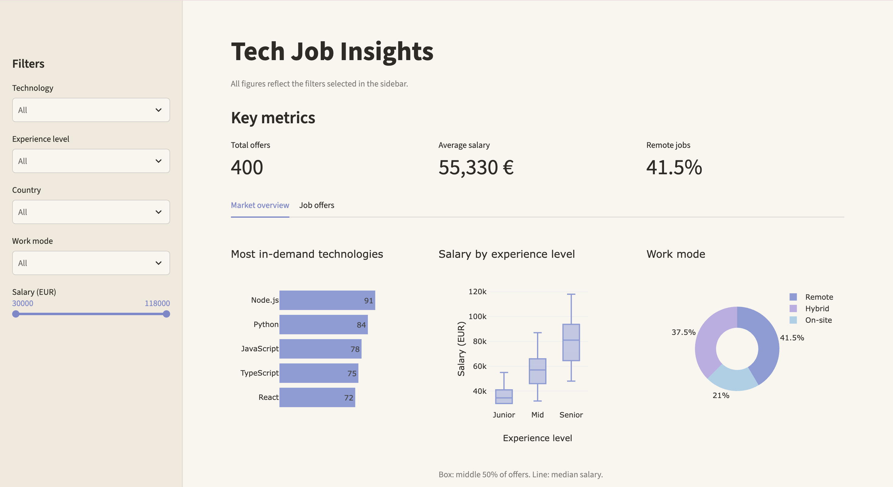
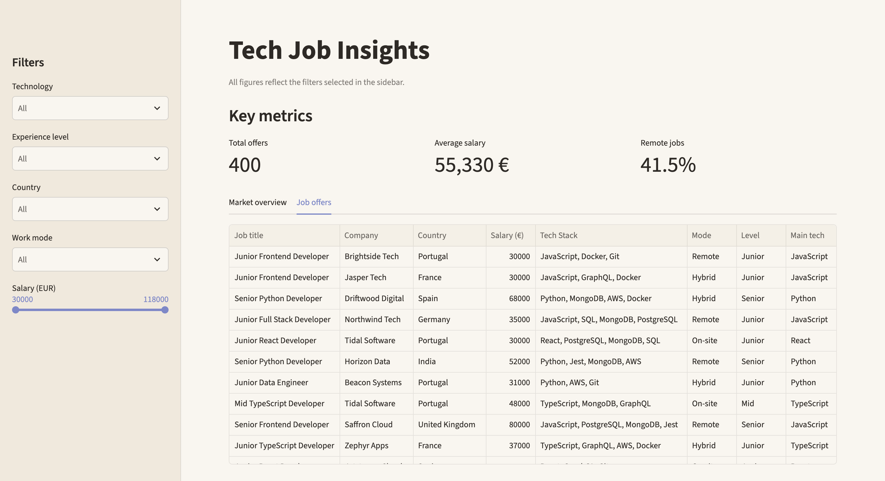

# Tech Job Insights

An interactive dashboard to explore the tech job market: most in-demand technologies, salaries by experience level and remote work opportunities.

Built with Python, pandas, Plotly and Streamlit.

> **Note:** the dataset is synthetic. It is generated by `scripts/generate_data.py`, so the project runs without any external service.


## Screenshots

### Market overview


### Job offers



## Features

- **Sidebar filters** by technology, experience level, country, work mode and salary range
- **Key metrics** that update with the filters: total offers, average salary and share of remote jobs
- **Interactive charts** with Plotly: most in-demand technologies, salary by experience level and work mode split
- **Jobs table** that can be sorted, searched and downloaded as CSV
- **Responsive layout** that adapts to smaller screens


## Tech stack

- **Python**: main language
- **pandas**: data loading, filtering and calculations
- **Streamlit**: web app and interactive widgets
- **Plotly**: interactive charts


## Run it locally

1. Clone the repository:

   ```bash
   git clone https://github.com/gabrielagb025/tech-job-insights.git
   cd tech-job-insights
   ```

2. Create and activate a virtual environment:

   ```bash
   python3 -m venv .venv
   source .venv/bin/activate
   ```

   On Windows, activate it with `.venv\Scripts\activate`.

3. Install the dependencies:

   ```bash
   pip install -r requirements.txt
   ```

4. Start the app:

   ```bash
   streamlit run app.py
   ```

To regenerate the sample dataset, run `python scripts/generate_data.py`.


## Roadmap

- [ ] Add a live data source through an external jobs API, with a CSV fallback
- [ ] Add a data source selector (sample data / live data)